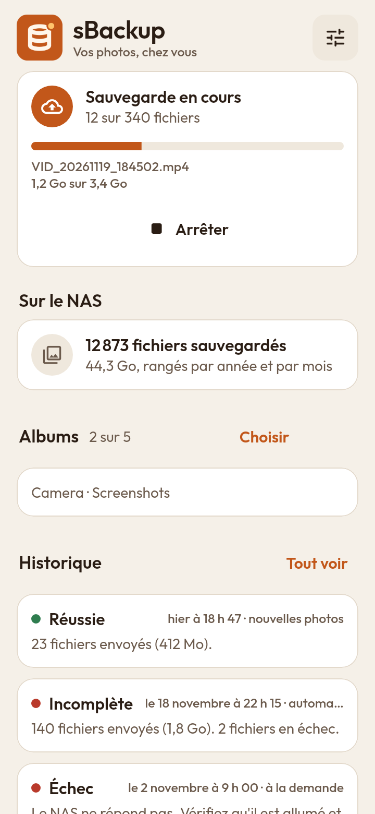
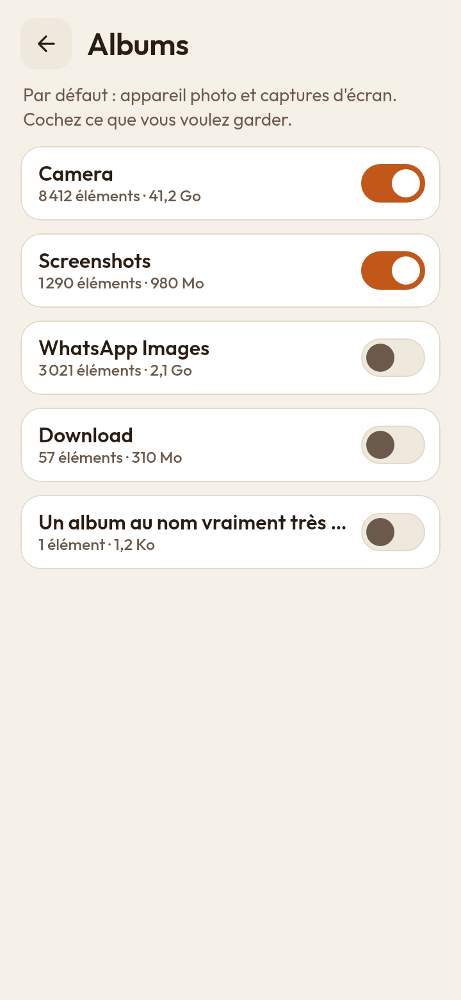
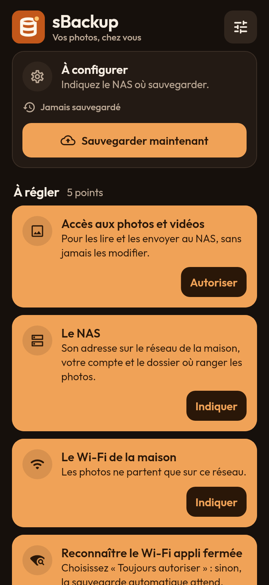

<h1 align="center">sBackup</h1>

<b>Vos photos et vidéos sauvegardées sur votre NAS, toutes seules, dès que vous rentrez à la maison.</b>

  
  

> **Première version.** Tout est en place et testé sur ordinateur, avec un NAS simulé,
> mais sBackup n'a pas encore tourné sur un vrai téléphone face à un vrai NAS. Vos photos
> ne risquent rien (sBackup ne supprime ni ne modifie jamais rien) ; au pire, une
> sauvegarde échoue et l'historique dit pourquoi.

Une alternative à Google Photos qui reste chez vous. Vous rentrez, le téléphone retrouve le
Wi-Fi de la maison, et les photos du jour partent sur votre NAS, rangées par année et par
mois. Pas d'abonnement, pas de nuage, et rien n'est jamais supprimé.

  
  
  

## Pourquoi sBackup

- **Vos souvenirs restent chez vous.** Ils vont du téléphone à votre NAS, sur le réseau de
  la maison, sans passer par Internet ni par le serveur de qui que ce soit.
- **Vous n'y pensez plus.** La sauvegarde se lance toute seule à l'arrivée de nouvelles
  photos et toutes les heures, seulement sur le Wi-Fi de la maison.
- **Rien ne se perd, rien ne s'écrase.** Chaque fichier est vérifié une fois arrivé, aucun
  fichier n'est jamais remplacé, et sBackup ne supprime rien, ni sur le téléphone ni sur le
  NAS.

## Ce que fait sBackup

### 🗄️ Votre NAS Synology, sans rien y installer
sBackup écrit sur le NAS par le partage Windows (SMB), déjà actif sur un Synology. Par
défaut, les photos arrivent dans votre espace personnel, dossier `Photos/Téléphone` :
l'application Synology Photos les affiche d'elle-même. Votre mot de passe reste chiffré
sur le téléphone, et un bouton « Tester » vérifie la connexion tout de suite.

### 🗂️ Les albums de votre choix
L'appareil photo et les captures d'écran sont cochés d'office ; ajoutez ou retirez
n'importe quel album (WhatsApp, Téléchargements…) d'un geste.

### ♻️ Une sauvegarde qui n'envoie que les nouveautés
Un fichier déjà sauvegardé n'est jamais renvoyé, même s'il est dans deux albums. Si le Wi-Fi
saute ou si le téléphone s'éteint en plein envoi, la sauvegarde reprend là où elle s'était
arrêtée, sans recommencer le fichier.

### ✅ Des fichiers vérifiés
Chaque fichier est relu sur le NAS et son empreinte comparée à l'original. Il n'est rangé à
sa place qu'une fois reconnu identique. La position GPS de vos photos est conservée.

### 📶 Seulement à la maison
sBackup reconnaît le Wi-Fi de la maison à son nom. Ailleurs, rien ne part. En option, il
attend aussi que le téléphone soit en charge.

### 📅 Rangé par année et par mois
Sur le NAS, les photos arrivent dans `2026/11/…`, avec leur nom d'origine. Si un fichier du
même nom existe déjà, le nouveau devient `IMG_1234 (2).jpg` : rien n'est écrasé.

### 📊 Vous savez où vous en êtes
Avancement en direct, date de la dernière sauvegarde, historique de chaque passage et
erreurs expliquées en français. Une notification discrète accompagne les gros transferts,
avec un bouton pour arrêter.

### 🔋 Pensé pour Android 15 et Samsung
Les sauvegardes passent par le planificateur d'Android (WorkManager) et deviennent un
service au premier plan pendant les gros transferts. sBackup vous guide pour l'exempter
de l'économie de batterie, sans quoi Samsung l'endormirait.

### 🌗 Clair ou sombre
Un thème clair et un thème sombre, au choix ou selon le téléphone.

## Prise en main

1. **Installez** sBackup sur le téléphone avec le bouton en haut de cette page.
2. **Suivez « À régler »** sur l'accueil : accès aux photos, le NAS (adresse IP, votre
   compte), le Wi-Fi de la maison, l'exemption de batterie.
3. **C'est tout.** Touchez « Sauvegarder maintenant » pour la première fois ; ensuite,
   tout se fait seul.

Le [guide d'utilisation](docs/GUIDE.md) détaille chaque réglage et les solutions aux soucis
courants.

## Questions fréquentes

**Faut-il un compte ou un abonnement ?** Non. sBackup est gratuit, sans compte, sans
publicité.

**Mes photos passent-elles par Internet ?** Non. Elles vont directement du téléphone au
NAS, sur le réseau de la maison.

**sBackup supprime-t-il les photos du téléphone une fois sauvegardées ?** Non, jamais. Il
ne supprime rien, ni sur le téléphone ni sur le NAS. Faire de la place reste votre choix.

**Pourquoi demande-t-il la localisation ?** Parce qu'Android ne donne le nom du Wi-Fi
qu'aux applications autorisées à la localisation. sBackup ne lit ni ne garde aucune
position.

**Et si je retouche une photo ?** La version retouchée est sauvegardée à côté de
l'originale, sous un nom voisin (`IMG_1234 (2).jpg`).

**Avec quel NAS ?** Tout NAS qui propose un partage Windows (SMB 2 ou 3) : Synology, QNAP,
un PC Windows… sBackup a été pensé autour d'un Synology DS415+.

**Avec quels téléphones ?** Android 11 ou plus récent. sBackup a été pensé autour d'un
Samsung Galaxy S25 sous Android 15.

## La famille sPack

sBackup fait partie de **sPack**, une famille d'applications pratiques pour la maison,
toutes dans le même style.

| | | | |
| :---: | :---: | :---: | :---: |
|  |  |  |  |
| **[sDash](https://github.com/ShinezeoGame/sDash)** Toute la maison sur une tablette | **[sPhone](https://github.com/ShinezeoGame/sPhone)** L'écran du téléphone sur le PC | **[sDrop](https://github.com/ShinezeoGame/sDrop)** Fichiers et textes entre téléphone et PC | **[sPing](https://github.com/ShinezeoGame/sPing)** Les notifications du téléphone sur le PC |
|  |  |  |   |
| **[sWatt](https://github.com/ShinezeoGame/sWatt)** La consommation électrique de la maison bientôt | **[sCam](https://github.com/ShinezeoGame/sCam)** Un vieux téléphone en caméra ou babyphone bientôt | **sBackup** Les photos du téléphone sauvegardées sur le NAS bientôt |   |

---

Fonctionnement, développement et logo : voir [docs/DEVELOPPEMENT.md](docs/DEVELOPPEMENT.md).
Police [Outfit](https://github.com/Outfitio/Outfit-Fonts) sous licence SIL Open Font License 1.1.
