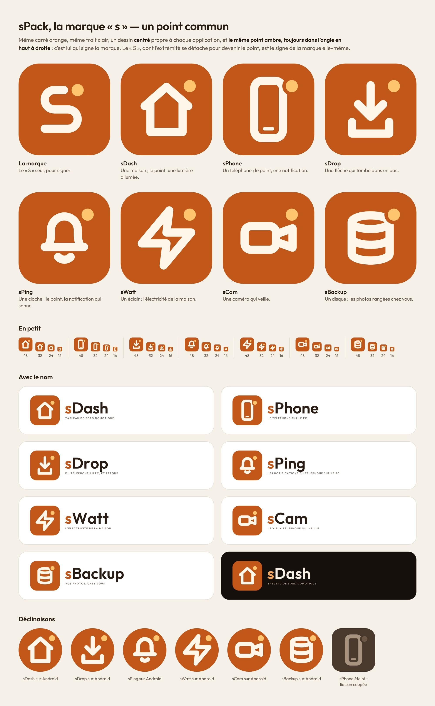

[← Retour à la présentation](../README.md)

# sBackup : fonctionnement et développement

## Comment ça marche

sBackup est une application [Flutter](https://flutter.dev) pour Android. Toute la logique
de sauvegarde est en Dart pur (`lib/core/`), testée sans téléphone ni NAS ; Android ne
fournit que la galerie, l'état du téléphone et la planification.

```
WorkManager (BackupScheduler.kt)
   └─ BackupWorker.kt ── moteur Flutter sans interface ──▶ sauvegardeArrierePlan() (lib/background.dart)
                                                             └─ BackupJob ─▶ BackupEngine ─▶ Destination
Interface (MainActivity.kt) ◀── ProgressHub.kt (avancement) ─┘                  │
                                                                    BackupIndex (index.jsonl)
```

- **`Destination`** (`lib/core/destination.dart`) : l'interface vers le NAS. Six
  opérations (`open`, `sizeOf`, `makeDirs`, `write`, `read`, `renameNoReplace`) et aucune
  suppression. `MemoryDestination` (avec coupures et corruptions simulées) et
  `LocalFolderDestination` servent aux tests. `lib/platform/destinations.dart` choisira le
  vrai protocole ; tant qu'il n'est pas branché, il renvoie `null` et la sauvegarde le dit.
- **`BackupEngine`** (`lib/core/engine.dart`), pour chaque fichier absent de l'index :
  1. empreinte SHA-256 du fichier du téléphone ;
  2. contenu déjà sauvegardé (même empreinte) → noté, rien n'est envoyé ;
  3. fichier déjà présent sur le NAS à sa place (`AAAA/MM/nom`, `nom (2)`…) avec la même
     empreinte → noté sans renvoi (cas d'une réinstallation ou d'un arrêt brutal) ;
  4. envoi dans `.sbackup-partiel/<empreinte>.part`, **à la suite** de ce qui y est déjà
     (reprise à l'octet) ;
  5. vérification : taille, puis relecture et empreinte (« vérification complète ») ; en
     cas d'écart, un second envoi complet, puis abandon de ce fichier avec explication ;
  6. renommage vers le premier nom libre de `AAAA/MM/`, **sans écrasement** ;
  7. ajout à l'index.
- **`BackupIndex`** (`lib/core/backup_index.dart`) : journal JSON Lines où l'on ne fait
  qu'ajouter. Clé d'un fichier : identifiant MediaStore, taille, date de modification. Une
  ligne coupée est ignorée à la lecture.
- **`BackupJob`** (`lib/core/backup_job.dart`) : un passage complet. Il vérifie les
  conditions (Wi-Fi de la maison par son nom, charge), liste les photos des albums
  choisis, surveille les conditions pendant l'envoi (toutes les 20 s), traduit les erreurs
  en français et écrit l'historique.
- **Android** (`android/app/src/main/kotlin/…`) :
  - `BackupScheduler` : passage horaire (réseau non facturé, charge en option), passage à
    l'arrivée d'une nouvelle photo (déclencheur sur le contenu de MediaStore, réarmé en
    fin de passage), passage immédiat (tâche prioritaire).
  - `BackupWorker` : démarre un moteur Flutter qui exécute `sauvegardeArrierePlan`. Au-delà
    de 50 Mo ou de 30 fichiers, il passe en **service au premier plan `dataSync`** avec
    une notification discrète (bouton « Arrêter » → `StopReceiver`). Un seul passage à la
    fois.
  - `SystemChannel` (canal `sbackup/systeme`) : albums et médias (`MediaQueries`), état
    du téléphone, autorisations, planification.
  - Autorisations : `READ_MEDIA_IMAGES/VIDEO` (+ sélection partielle d'Android 14),
    `ACCESS_MEDIA_LOCATION` (position GPS conservée), localisation fine et en arrière-plan
    (nom du Wi-Fi), notifications, exemption d'optimisation de batterie.
- Fichiers partagés par l'interface et l'arrière-plan, dans le dossier privé de
  l'application : `reglages.json`, `index.jsonl`, `historique.json` (`lib/data_files.dart`).

## Ce qui est vérifié, et comment

- **Par les tests** (`flutter test`) : le moteur et les passages complets contre une
  destination en mémoire et un vrai dossier (coupure et reprise, fichier abîmé, conflit
  de noms, index perdu, doublons, fichier disparu, Wi-Fi perdu en route), et l'interface
  à trois tailles d'écran, en thème clair et sombre, avec le texte agrandi.
- **Par la compilation seulement** (CI GitHub) : tout le code Android (Kotlin, manifeste,
  WorkManager, service au premier plan). Il n'a pas encore tourné sur un vrai téléphone.

## Développement

Flutter 3.47, SDK Android.

- Vérifications avant chaque envoi : `dart format -l 120 lib test`, `flutter analyze`,
  `flutter test`.
- Captures de la documentation : `SBACKUP_CAPTURES=1 flutter test test/captures_test.dart`.
- `.github/workflows/build.yml` vérifie le format, analyse, teste, compile l'APK
  (`sbackup-android`) et publie la version à chaque envoi sur `main` ou à la demande
  (bouton « Run workflow », case « Publier »). Un changement qui ne touche que la
  documentation ne déclenche ni compilation ni publication.
- Clé de signature Android (facultative, pour que les mises à jour s'installent
  par-dessus l'ancienne version) : secrets `ANDROID_KEYSTORE_BASE64` et
  `ANDROID_KEYSTORE_PASSWORD` du dépôt.

## Logo

sBackup partage sa marque avec la famille sPack : le même carré orange, le même trait
clair, et le même point ambre, toujours au même endroit. Seul le dessin change : ici un
disque de stockage, celui du NAS.



`tools/logo/generer_logo.py` (identique dans tous les dépôts de sPack, seule
`APPLI_DU_DEPOT` diffère) produit les SVG de `docs/logo/` ; `tools/logo/exporter.py` en
tire les PNG et les icônes Android. L'icône de notification
(`res/drawable/ic_notification.xml`) reprend le tracé `DISQUE`.

## Licences

Police [Outfit](https://github.com/Outfitio/Outfit-Fonts) sous licence SIL Open Font License 1.1
(`assets/fonts/OFL.txt`).
